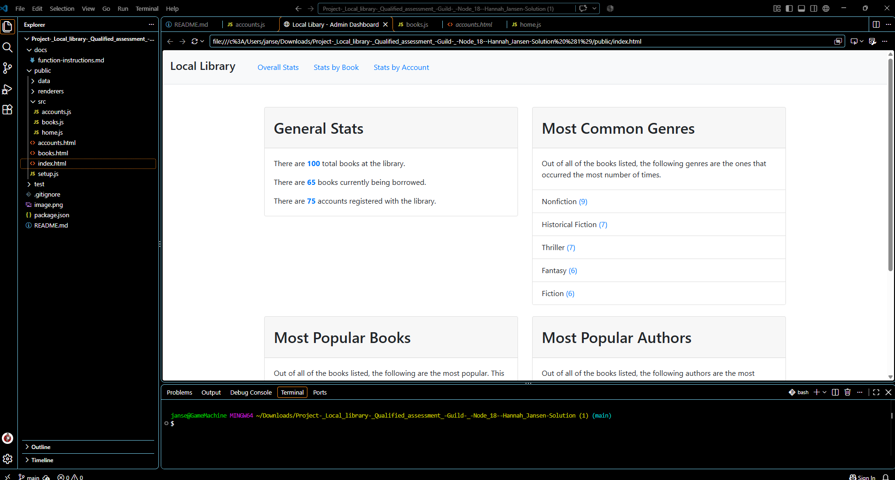
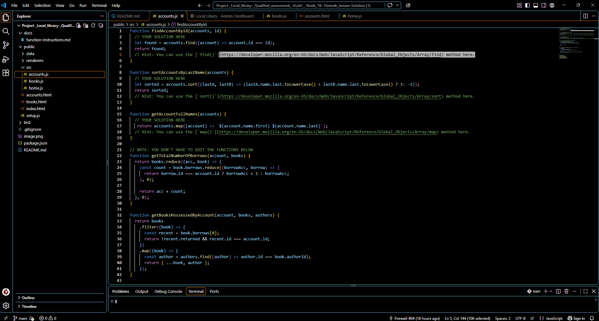
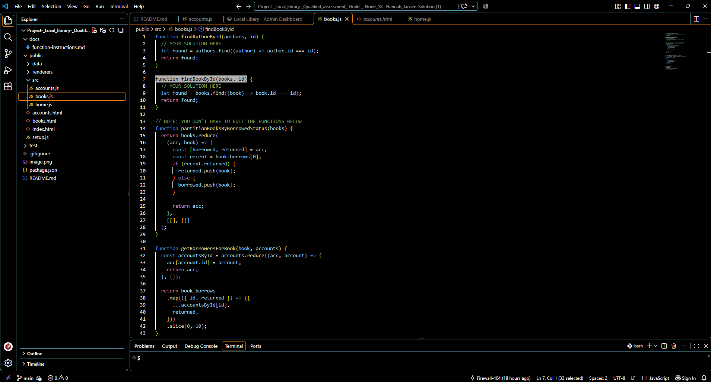
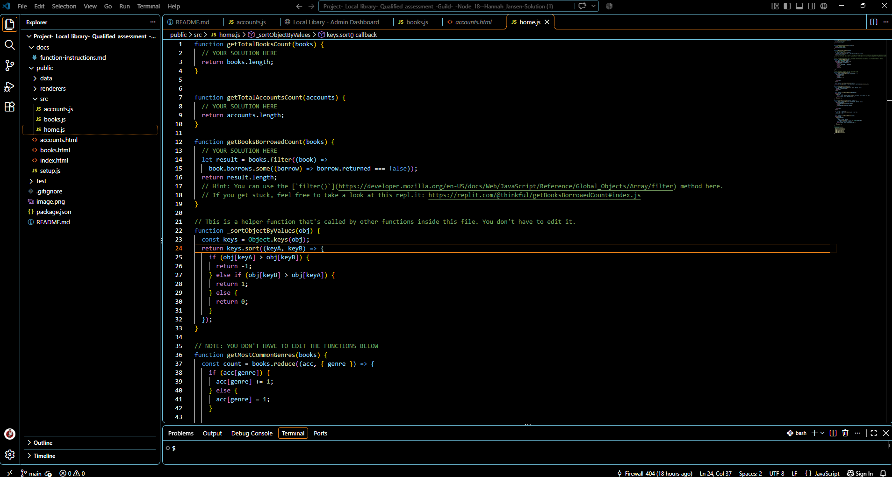
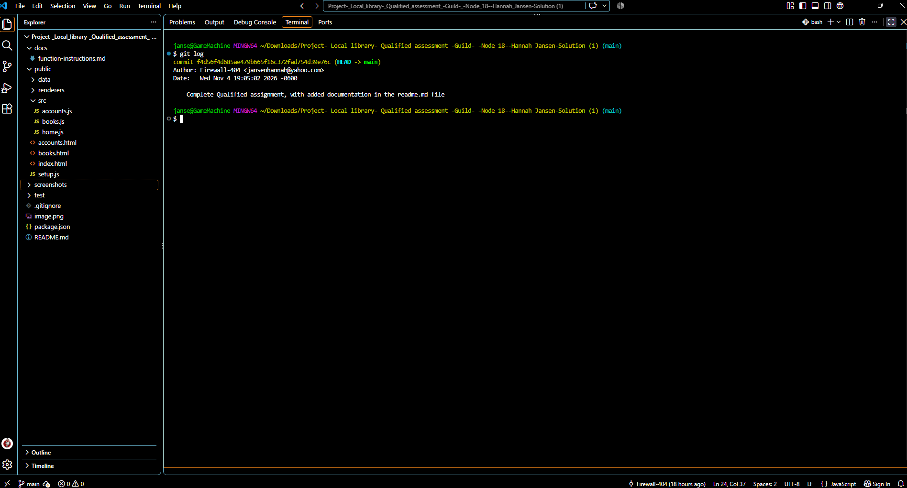

## Project summary

QUALIFIED WORK AND PROJECT DESCRIPTION
**project completed in qualified web ide and then downloaded onto local desktop to complete documentation and upload onto github**

Your neighborhood has decided to put together a local library where people can lend and borrow books. One of the most important features needed to organize this is a dashboard that will show which books are available, which are currently out, and other general statistics about the program.

Other people are taking care of the logistics and design, but they need you to build the algorithms.

## Completing each function

Using the hints, I used the mozilla documentation and the function-instructions.md to complete functions. This also helped meet the requirements of using both native array methods: find() and filter(). No AI was utilized in this project. 

[ACCOUNTS]

- function findAccountById(accounts, id)
Hint: You can use the [`find()`](https://developer.mozilla.org/en-US/docs/Web/JavaScript/Reference/Global_Objects/Array/find) method here.

The find() method of Array instances returns the first element in the provided array that satisfies the provided testing function. If no values satisfy the testing function, undefined is returned.

- function sortAccountsByLastName(accounts)
Hint: You can use the [`sort()`](https://developer.mozilla.org/en-US/docs/Web/JavaScript/Reference/Global_Objects/Array/sort) method here. 

The sort() method of Array instances sorts the elements of an array in place and returns the reference to the same array, now sorted.

-function getAccountFullNames(accounts)
Hint: You can use the [`map()`](https://developer.mozilla.org/en-US/docs/Web/JavaScript/Reference/Global_Objects/Array/map) method here.

The map() method of Array instances creates a new array populated with the results of calling a provided function on every element in the calling array.

[BOOKS]

-function findAuthorById(authors, id)
-function findBookById(books, id)

(https://developer.mozilla.org/en-US/docs/Web/JavaScript/Reference/Global_Objects/Array/find)

[HOME]

-function getTotalBooksCount(books)
-function getTotalAccountsCount(accounts)

-function getBooksBorrowedCount(books)
Hint: You can use the [`filter()`](https://developer.mozilla.org/en-US/docs/Web/JavaScript/Reference/Global_Objects/Array/filter) method here. 

## Implimenation 

This project will be able to be utilized by the local library for readers to access. 

The css and html of the website is already taken care of. It will have general stats, but navigation will be by authors, books, and accounts. One of the most important features needed to organize this is a dashboard that will show which books are available, which are currently out, and other general statistics about the program. 

## Running screenshots

Example of working project in integrated browser

Added code into accounts.js

Added code into books.js

Added code into home.js

## Commit History

This project was completed in the Qualified Web ide which I do not have access to anymore.

## Project rubric
For your project to pass, all of the following statements must be true. These criteria are reflected in the rubric in the following lesson.

All tests are passing in Qualified.

The project doesn't include any single-letter variables.

The project makes at least one use of an arrow function.

The project makes at least one use of each of the following native array methods: find() and filter().

The project uses at least one of the following JavaScript features: the ternary operator, the spread operator, object shorthand, array or object destructuring, and for/in loops.

The project submission includes a detailed README section containing the following:

A plan detailing the functions, features, algorithms, and other coding choices for the project

An implementation plan describing how you intend to implement your plan

The description of an example of an acceptable navigation structure

A reflection of the coding trade-offs you made for the project

Justification of your choices, challenges, and debugging or troubleshooting moments

A list of the AI tools used with justification

A short 100 to 150 words (or 3 bullets) summary regarding the project process

GitHub commit history and Replit screenshots illustrating each decision
